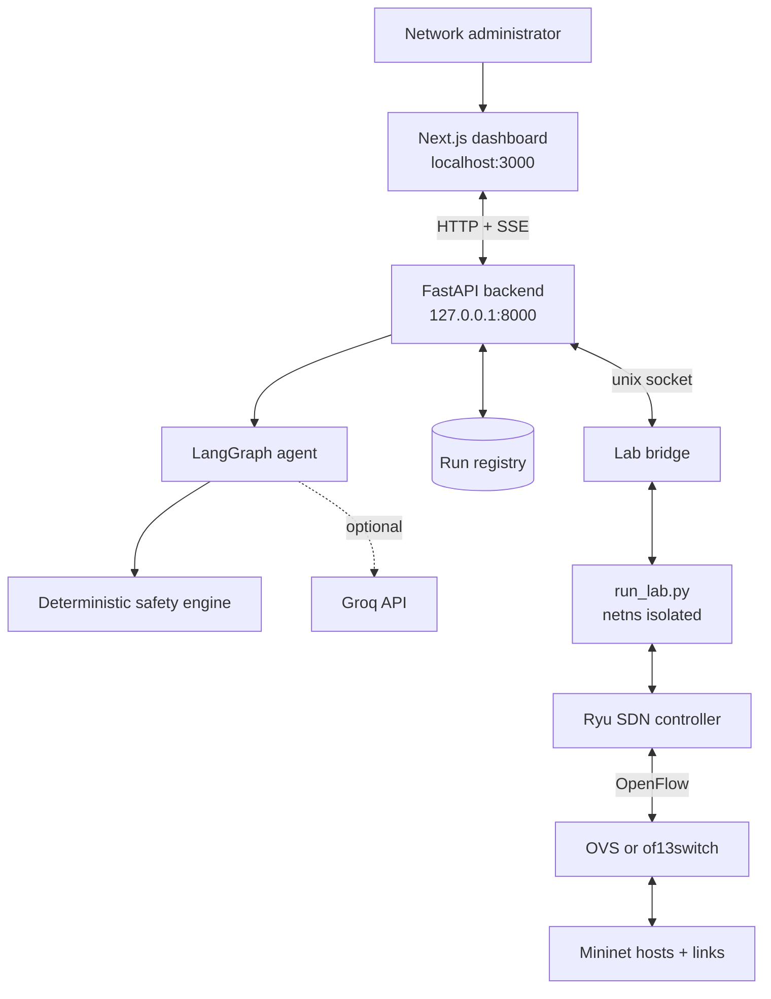

# Trustworthy Agentic AI for Intent-Based Self-Healing SDN

A locally-running SDN lab where you state a network intent in plain language and
an agent either heals the network, abstains because it lacks evidence, or
reports that recovery failed — and every one of those outcomes is backed by a
real measurement from a live OpenFlow network.

The research question is not "can an LLM reroute traffic". It is **can an agent
recover a network safely when a user-defined performance goal is violated, while
every decision it makes is supported by sufficient evidence and verified against
actual telemetry.** The LLM is used for intent parsing, evidence narration and
explanation. It is never the authority on whether to change the network.

## Demo scenario

An administrator wants video latency below **50 ms**. A link becomes congested,
latency rises, and the administrator types into the dashboard:

> optimise latency so that it comes under 50 ms

The agent then either detects the violation and reroutes, or explains precisely
why it declined to act. Both are correct outcomes.

## Three trustworthiness gates

The core contribution. Each gate is ordinary deterministic Python that works
even if the LLM returns a malformed or overconfident answer.

| Gate | Question | On failure |
| --- | --- | --- |
| **1. Evidence** | Are the required measurements present, fresh, and sane? | Refresh, or **abstain** — a refusal, never a success |
| **2. Safety** | Is this mutation allow-listed, valid, and does it spare protected flows? | **Reject**, or hold for human approval |
| **3. Verification** | Did the network actually get better when re-measured? | Report **failed / partial / unverified** |

Gate 3 exists because a successful command is not a successful recovery. A
reroute that installs cleanly but changes nothing must be reported as a failure.

The gate outcomes are deliberately distinct. "The intent is already met" (a
confident no-op), "the evidence is inconclusive" (a refusal), "the action was
rejected", and "recovery failed" are four different results and never collapse
into each other.

## Architecture

Everything runs locally. The only external runtime dependency is the Groq API,
which is optional — the agent runs fully deterministically without it and says so
rather than pretending otherwise.



The LLM is used only for intent parsing, evidence narration and explanation. It
has no direct access to switches or the shell.

The lab runs inside its own network namespace (`unshare -Urn`) so demo traffic
can never touch real interfaces, and exposes its API on a **unix domain socket**
so no TCP port is opened for network control.

### Agent workflow

Ten explicit LangGraph nodes with conditional routing:

```
intent detection → observation → evidence gate ─┬─ satisfied → stop
                                                 ├─ abstain   → stop
                                                 └─ diagnose → plan
        → action generation → safety gate ─┬─ rejected → stop
                                           ├─ hold     → stop
                                           └─ execute → re-observe
        → verification gate → explanation + audit
```

Typed state throughout: `run_id`, `intent`, `evidence_status`,
`diagnosis_summary`, `candidate_actions`, `validation_result`,
`execution_result`, `verification_result`, `final_outcome`.

## Repository layout

```
apps/web/          Next.js dashboard (React + TypeScript, hand-rolled SVG topology)
services/api/      FastAPI backend, LangGraph agent, safety engine, persistence models
network-lab/       Mininet lab, Ryu controller, user-space OpenFlow switch, telemetry
scripts/           One-time setup helpers (mnexec build, ryu checkout)
PROJECT_SPEC.md    The full build specification this implements
```

### The network topology

Hosts attach to the edges of a four-switch ring:

```
  h1 (video src)      h2 (congestion src)
       │                   │
      s1 ────── s2 ────── s4 ────── s3
                             │         │
                          h4 (video   h3 (voice,
                             sink)     protected)
```

The ring is s1–s2–s4–s3–s1, so there are two independent routes between the
video source and sink — `s1-s2-s4` (10 ms) and `s1-s3-s4` (20 ms). That
redundancy is what makes rerouting possible, and the ring is also why the switch
needs a loop guard: a bridged ring with no spanning tree floods broadcasts
forever.

- **`s2-s4`** is the congestible link that the scenario loads.
- **`h3→h4`** is the protected voice flow, which a recovery must not harm.
- **`h2→h3`** is the congestion generator's path, forced over `s2-s4` by the
  shortest route.

## Prerequisites

- Python 3.12+
- Node.js 20+
- Linux with user namespaces (`unshare -Urn`) and `AF_PACKET` support
- Optional: PostgreSQL (SQLite fallback works for development)
- Optional: a Groq API key

## Setup

```bash
# 1. Build the mnexec helper Mininet needs but does not ship
bash scripts/setup-mininet.sh

# 2. Vendored Ryu checkout (the lab imports `ryu` from here)
bash scripts/setup-ryu.sh

# 3. Python + Node dependencies
#    The backend runs from its own directory (it resolves `app.*` there), so
#    installing its dependencies is enough -- no editable install is needed.
python3 -m venv .venv
.venv/bin/pip install fastapi 'uvicorn[standard]' pydantic pydantic-settings \
    langgraph sqlalchemy 'psycopg[binary]' alembic httpx python-dotenv groq
.venv/bin/pip install pytest pytest-asyncio ruff
(cd apps/web && npm install)

# 4. Configuration
cp .env.example .env    # then fill in GROQ_API_KEY if you have one
```

Two artifacts are built rather than committed: `network-lab/bin/mnexec` (the
PyPI mininet package ships no C sources) and the vendored Ryu checkout.

## Running it

Three processes, three terminals:

```bash
# Terminal 1 — the network lab (needs the namespace privileges)
bash network-lab/scripts/start-lab.sh
#   follow with: tail -f logs/lab.log

# Terminal 2 — the backend
cd services/api && ../../.venv/bin/python -m uvicorn app.main:app \
    --host 127.0.0.1 --port 8000

# Terminal 3 — the dashboard
cd apps/web && npm run dev
```

Then open <http://localhost:3000>.

Stop the lab with `bash network-lab/scripts/stop-lab.sh`. It refuses to start a
second instance, because an orphaned controller inside a dead namespace would
absorb the new switches and the lab would look healthy while never connecting.

### Try the demo

1. Confirm a clean baseline: `h3→h4` around 1–5 ms, `h1→h4` around 20–25 ms.
2. Click **Create Congestion**. The s2-s4 edge goes red and dashed, and
   utilisation rises on that link in both the table and the topology.
3. Ask the agent: *optimise latency so that it comes under 50 ms*.
4. Watch the Agent Activity timeline: evidence gathered, gate decisions, and
   either an executed reroute or a stated reason for not acting.

## Tests

```bash
# Backend unit + integration (no lab required)
cd services/api && ../../.venv/bin/python -m pytest tests -m "not live"

# Frontend end-to-end (starts its own dev server)
cd apps/web && npm run test:e2e
```

Live-lab tests are marked and opt in:

```bash
cd services/api && ../../.venv/bin/python -m pytest tests -m live
```

Tests that came out of a real defect found against a running lab say so in
their docstring and name the failure they prevent. Two examples:

- `test_samples_over_target_are_violated_despite_low_mean` — the agent compared
  only a flow's *mean* against the target, so a flow oscillating around 50 ms
  averaged 41.8 ms and the agent reported `intent_satisfied` while the dashboard
  showed a breach.
- `test_congestion_free_path_outranks_a_faster_congested_one` — path ranking
  used raw delay alone, so the planner preferred an 18 ms detour *through* the
  congested link over the 20 ms path that avoided it.

## How it fails

Worth stating plainly, because a trustworthy system is defined by what it does
when it does not know:

- **Telemetry missing or stale** → the agent abstains and says which measurement
  it could not get. It does not guess.
- **No measurement at all** → reported as *unknown*, never as *not violated*.
- **All candidate paths unsafe** → every rejection is reported with its reason.
- **Command succeeded but latency unchanged** → `recovery_failed`. Command
  success and recovery success are different claims.
- **LLM unavailable** → deterministic mode, reported as such in the run record.
- **Lab unreachable** → HTTP 503, never a blank-but-healthy-looking 200.
- **Real lab unavailable** → the system must not silently substitute mock data.

## Project status

Working end to end against the live lab: topology and metrics stream, the
congestion scenario generates real load, and the agent gathers evidence, applies
all three gates and reports a terminal outcome. What is not finished is durable
persistence (see limitations) and proactive monitoring, which is implemented as
a placeholder endpoint only.

## Current limitations

Stated rather than glossed over:

- **Runs are process-local.** The run registry and event history live in memory
  (bounded at 200 runs); restarting the backend loses them. The SQLAlchemy models
  for runs, conversations, audit entries and telemetry exist but are not yet
  written to, and there is no migration set or LangGraph checkpointer.
- **The user-space datapath plateaus near 40 Mbps.** `of13switch.py` is a pure
  Python OpenFlow switch; it forwards correctly but saturates well below a
  1 Gb/s link. Offered load above that is dropped, which is real congestion
  behaviour rather than a measurement error, but it means a 400 Mbps scenario
  does not produce 400 Mbps of throughput.
- **Congestion may not breach 50 ms on its own.** Because the datapath no longer
  stalls the control plane, the default scenario sometimes leaves video latency
  comfortably inside the intent — and the agent correctly does nothing. Raising
  the offered rate or narrowing the link is needed to force a reroute for demo
  purposes.
- Single-host, single-user by design.

## Licence

No licence file has been added yet. Add one before distributing this code.